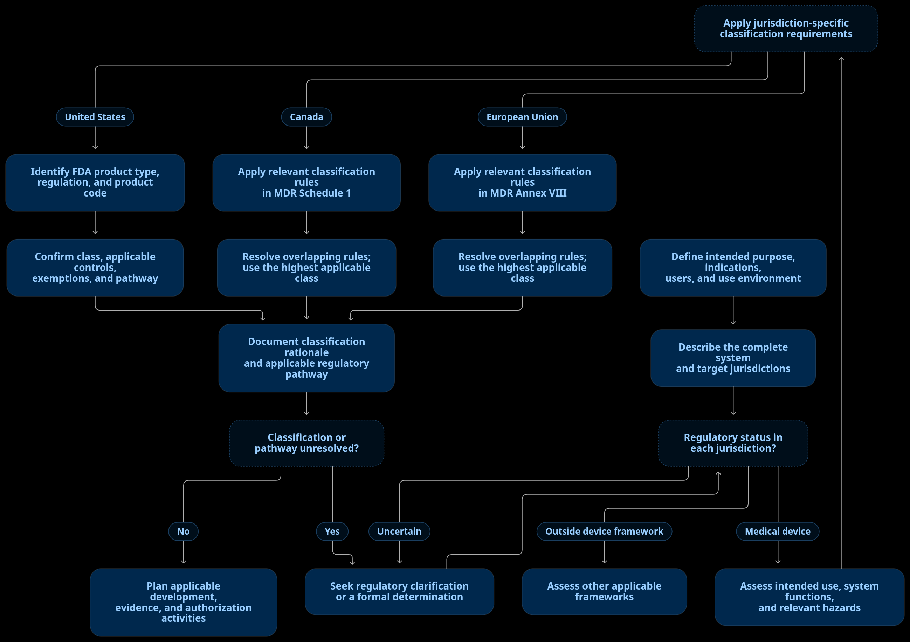

# Medical-device regulatory considerations for Openwater integrators

> Introductory guidance for developers building with Open-LIFU and Open-Motion. This document identifies questions to assess; it does not establish regulatory status, demonstrate compliance, or authorize clinical use.

## 1. Scope and existing research-use restrictions

Openwater publishes hardware, firmware, software, and technical documentation that developers may use as inputs to research and development. Integrating these inputs into a system with a medical purpose can introduce regulatory obligations for the organization responsible for that system.

Read the existing notices before using a platform:

- [Openwater research-use notice](https://docs.openwater.health/#investigational-devices).
- [Open-LIFU research-use notice and platform warnings](https://docs.openwater.health/openlifu/#research-use-only).
- [Open-Motion research-use notice and platform warnings](https://docs.openwater.health/openmotion/).
- [Open-Motion Research User Manual](https://docs.openwater.health/openmotion/user-manual/).
- [Open-LIFU Best Practices](https://docs.openwater.health/openlifu/best-practices/) and [Open-Motion Best Practices](https://docs.openwater.health/openmotion/best-practices/).

These notices and the applicable controlled platform manuals remain the references for research-use restrictions and operating precautions. This document does not replace, relax, or expand them. In particular, it does not permit diagnostic or therapeutic procedures or commercial sale contrary to the platform notices. Open-source licensing permits specified reuse of intellectual property; it does not provide regulatory authorization.

The published Best Practices describe upstream development approaches. References to quality systems, IEC 62304 principles, safety features, or testing are not evidence that every release, modification, or finished system meets all applicable requirements. Published results must be assessed against the actual version, configuration, intended use, and test conditions.

This is educational guidance, not a legal opinion, a classification decision, a clinical-use instruction, or a conformity assessment.

## 2. When can an integration become a medical device?

The following are summaries of the definitions, with **the portions most relevant to these platforms emphasized**. Consult the linked legislation for the complete wording, exclusions, and context. Meeting a definition and determining a device's class or authorization pathway are separate questions.

### United States: FDA

Under section 201(h)(1) of the Federal Food, Drug, and Cosmetic Act, the device definition covers instruments and related articles, **including components, parts, and accessories**, meeting one of the statutory criteria. Those criteria include recognition in specified official compendia; an intended purpose involving **diagnosis, cure, mitigation, treatment, or prevention of disease or other conditions**; or an intention to **affect body structure or function**. The definition also distinguishes devices by their primary mode of action: the primary intended purposes are not achieved through chemical action in or on the body and are not dependent on metabolism. Certain software functions are excluded under section 520(o).

**Relevance:** A system intended to stimulate neural activity may raise the structure/function criterion even without a disease-treatment claim. An optical measurement system intended to inform diagnosis or disease monitoring may raise the diagnostic criterion. An SDK, controller, or subsystem needs assessment in its own intended-use context; calling it a component does not automatically remove regulatory considerations.

Source: [FDA: How to Determine if Your Product is a Medical Device](https://www.fda.gov/medical-devices/classify-your-medical-device/how-determine-if-your-product-medical-device).

### Canada: Health Canada

Section 2 of the Food and Drugs Act defines a device to include instruments and similar articles, in vitro reagents, and **their components, parts, or accessories**, manufactured, sold, or represented for specified purposes. These include **diagnosing, treating, mitigating, or preventing disease, disorders, abnormal physical states, or symptoms**, and **restoring, modifying, or correcting body structure or the functioning of a body part**. The definition also covers pregnancy-related care and diagnosis and prevention of conception. It excludes articles achieving the listed actions solely through the specified pharmacological, immunological, metabolic, or chemical means.

**Relevance:** Both the proposed function and how the system is represented matter. Physiological measurements represented for identifying an abnormal state, or ultrasound intended to modify physiological function, warrant assessment. A research-use label alone does not settle the regulatory position of a proposed medical application.

Source: [Food and Drugs Act, section 2: device](https://laws-lois.justice.gc.ca/eng/acts/f-27/page-1.html).

### European Union: Medical Device Regulation

Article 2(1) of Regulation (EU) 2017/745 covers instruments and other articles, **expressly including software**, intended by the manufacturer for human use, **alone or in combination**, for specified medical purposes. These include diagnosis, prevention, monitoring, prediction, prognosis, treatment, or alleviation of disease; purposes relating to injury or disability; **investigation, replacement, or modification of anatomy or a physiological or pathological process or state**; and information from in vitro examination of human specimens. The principal intended action is not pharmacological, immunological, or metabolic, although such means may assist it. The article also includes specified products for conception control or support and device cleaning, disinfection, or sterilization.

**Relevance:** Software that interprets measurements for a medical purpose, or controls energy delivery within a medical system, requires assessment in that role. Combining a research platform with other equipment does not remove the need to assess the resulting system. Article 2(12) links intended purpose to information supplied by the manufacturer, including labeling, instructions, promotional or sales materials, and the clinical evaluation. Separately, some products without an intended medical purpose fall within Annex XVI; this can matter for certain brain-stimulation applications and requires a specific scope assessment.

Source: [EU MDR, Article 2 and Annex XVI](https://eur-lex.europa.eu/legal-content/EN/TXT/?uri=CELEX:32017R0745).

### Practical interpretation

Define the proposed purpose, users, population, environment, outputs, and role in decisions before assessing regulatory status. Illustrative triggers include:

| Proposed activity | Question to assess |
|---|---|
| Bench measurements on a phantom | What laboratory, electrical, optical, or acoustic safety requirements apply, even without a medical-device use? |
| Applying ultrasound to change neural activity | Does the proposed function meet a device definition or another regulated product category? What restrictions govern the research? |
| Using optical results to identify disease or guide treatment | Does the measurement or interpretation function have a medical intended purpose? |
| Embedding Openwater software in a new medical product | What obligations apply to the software, its interfaces, and the finished system? |

These examples are prompts for assessment, not determinations. Research use and investigational use do not create a blanket exemption. Ethics approval and regulatory authorization are separate considerations; neither is established by this documentation.

### Research applications: controls reduce risk, not regulatory duties

A study may reduce exposure and the chance or consequences of harm by keeping work in a defined, supervised research setting and limiting participation to a justified, carefully screened population. These measures can be important risk controls, but **they do not by themselves change the device's intended purpose or class, make a device non-medical, or waive applicable investigational, ethics, or other regulatory requirements**. Research use is not a regulatory safe harbor.

Before enrolling participants, the responsible institution and sponsor should establish which ethics review, informed-consent, investigational authorization or notification, and site or operator requirements apply in each jurisdiction. The protocol should define eligibility and exclusion criteria based on the device-specific hazards and scientific rationale; specify trained operators, supervision, use environment, permitted configurations and parameters, stopping rules, emergency response, and adverse-event reporting; and describe how deviations and changes will be reviewed. Screening criteria should be proportionate, consistently applied, and reviewed by the appropriate ethics and regulatory bodies. A narrow, low-risk cohort or tightly controlled protocol can support a lower-risk study design, but it does not itself determine the device's regulatory classification or authorize the study.

## 3. How to work out the device class

Classification follows the finished device's **intended purpose and applicable jurisdiction-specific rules**. Risk is central, but a general risk score or a comparison with another product does not determine the class. First define the device and its claims; then apply the classification rules or FDA classification entry that matches it. Use the highest class indicated by any applicable rule when the framework directs this. Repeat the assessment for each jurisdiction: US, Canadian, and EU classes are not interchangeable.

### Apply the decision path

1. **Fix the device boundary and purpose.** Describe the finished system, including integrated software and accessories, what it does, who uses it, for whom, and what medical decisions or interventions it supports. Classification can change when the intended purpose, claims, configuration, or role in a system changes.
2. **Consider the worst credible case within that intended use.** Evaluate the most serious reasonably foreseeable harm from the device's operation, failure, or use error, considering factors such as invasiveness, duration and site of contact, energy delivered, diagnostic or treatment role, and consequences of an incorrect output. This informs risk; it does not replace the legal classification rules or mean that every imaginable misuse sets the class.
3. **Apply the rules for each market.** In the US, identify the FDA product classification entry and its regulation, class, exemptions, and controls; do not assign a class from a generic risk matrix alone. In Canada, work through the applicable rules in Schedule 1 of the Medical Devices Regulations. In the EU, apply the rules in MDR Annex VIII, using the manufacturer's intended purpose.
4. **Resolve overlapping rules and record the result.** Where more than one rule applies, follow that framework's rule for the highest class. Record the device boundary, intended purpose, rules or FDA entry considered, rationale, assumptions, and unresolved questions. If the classification is unclear, seek advice or a formal determination from the relevant authority before relying on it.

As a broad orientation only, the US has Classes I–III, Canada has Classes I–IV, and the EU has Classes I, IIa, IIb, and III (with certain Class I device subtypes). Class I is generally the lowest-risk tier in each system, but the numbering and criteria do not translate directly. **Class II is a common planning hypothesis for many active diagnostic or therapeutic systems, including some systems built around these platforms; it is not a default or a classification conclusion.** Depending on intended use and the rules, an integration could fall in a different class, including a higher one. Confirm the classification for the particular finished device and market.

Primary references: [FDA: Classify Your Medical Device](https://www.fda.gov/medical-devices/overview-device-regulation/classify-your-medical-device); [Canada: Medical Devices Regulations, Schedule 1](https://laws-lois.justice.gc.ca/eng/regulations/SOR-98-282/); [EU MDR, Article 51 and Annex VIII](https://eur-lex.europa.eu/legal-content/EN/TXT/?uri=CELEX:32017R0745).

## 4. Standards that may be relevant

The references below are a starting point for assessing applicability, **not a universal compliance checklist**. Select standards and editions against the finished system, intended use, hazards, jurisdiction, and applicable regulatory framework. Check amendments, national or regional adoptions, recognition or harmonization status, and transition arrangements. A newer international edition is not automatically the edition accepted for a particular submission.

| Reference | Subject | Potential relevance |
|---|---|---|
| [ISO 13485](https://www.iso.org/standard/59752.html) | Medical-device quality management systems | Design controls, supplier controls, configuration management, records, and change control within the responsible organization's QMS. A repository does not confer QMS certification. |
| [ISO 14971](https://www.iso.org/standard/72704.html) | Medical-device risk management | System hazards, hazardous situations, risk controls, residual risk, and information from production and use. Includes interactions between software, hardware, users, and energy delivery. |
| [IEC 62304](https://www.iso.org/standard/38421.html), including applicable amendments | Medical-device software life-cycle processes | Software development and maintenance, safety classification, SOUP evaluation, configuration management, and problem resolution. Does not itself cover validation and final release of the finished device. |
| [IEC 62366-1](https://webstore.iec.ch/en/publication/21863), including applicable amendments | Safety-related usability engineering | User interfaces, setup, parameter entry, warnings, and use errors that could affect safe operation. |
| [IEC 60601-1](https://webstore.iec.ch/en/publication/2606) and applicable collateral and particular standards | Basic safety and essential performance | Medical electrical equipment and systems, including the integrated console, host, power supplies, connections, and applied parts where in scope. |
| [IEC 60601-1-2](https://webstore.iec.ch/en/publication/2590) | Electromagnetic disturbances | Emissions and immunity of the relevant system configuration, with safety and essential-performance criteria tied to the use environment. |
| [IEC 81001-5-1](https://committee.iso.org/standard/76097.html) | Secure health-software life-cycle activities | Threat assessment, dependencies, secure development, vulnerability handling, and updates. Connectivity is not the only source of cybersecurity risk. |
| [ISO 10993-1](https://www.iso.org/standard/84512.html) and applicable parts | Biological safety evaluation | Materials contacting the body, such as coupling interfaces, pads, and sensor contact surfaces, assessed for their nature and duration of contact. |
| [IEC 62127-1](https://webstore.iec.ch/en/publication/75130) | Hydrophone measurement of medical ultrasonic fields | Acoustic field characterization and measurement uncertainty for Open-LIFU-derived configurations; measurement alone does not establish safe exposure. |
| [IEC 60601-2-62](https://webstore.iec.ch/en/publication/2678) | High-intensity therapeutic ultrasound equipment | Assess scope before use. Open-LIFU's low-intensity designation does not justify assuming this particular standard applies, or that it supplies appropriate neuromodulation exposure limits. |
| [IEC 60825-1](https://webstore.iec.ch/en/publication/3587); [IEC 60601-2-22](https://webstore.iec.ch/en/publication/31111) where in scope | Laser product safety; particular requirements for specified medical laser equipment | Open-Motion-derived optical systems require assessment of accessible emissions, operating and fault conditions, and laser classification. IEC 60601-2-22 has a specific scope; an enclosed higher-class source does not by itself establish applicability to the finished product. |

Additional standards or requirements may concern cleaning and reprocessing, labeling, clinical investigations, data protection, or the particular modality and application. General electrical or software standards do not supply a complete application-specific safety case. For example, transcranial ultrasound assessment may also need to address targeting, coupling, skull effects, heating, and unintended stimulation; optical assessment may need to address exposure and the validity of the derived measurements.

## 5. SOUP: assessing reused Openwater software

**SOUP means software of unknown provenance**, the term used in IEC 62304. It encompasses previously developed software not developed for incorporation into the medical device, or software for which adequate development-process records are unavailable. It does not mean that the author or source code is necessarily unknown.

For integration planning, **treat reused Openwater software as SOUP unless a documented assessment establishes that adequate development records are available and an alternative treatment is justified under the applicable process**. Record that conclusion for each software item and version. This is a conservative integration assumption, not a finding that all Openwater software lacks adequate records. Open-source status alone neither establishes nor excludes SOUP status. SOUP applies to software items, not to the entire hardware platform.

A useful SOUP assessment addresses:

1. **Identity and boundaries:** repository, release or commit, supplier, function, dependencies, and build/runtime environment. An SBOM supports this inventory but is not the complete analysis.
2. **Required behavior:** the functions and performance needed from the item, its interfaces, and the hardware/software conditions needed for correct operation.
3. **Failure and security effects:** how incorrect outputs, timing, communication loss, incompatible dependencies, or vulnerabilities could contribute to hazardous situations.
4. **Known anomalies:** available issue reports, release notes, security advisories, and supplier information relevant to the selected version, with their possible effects and dispositions.
5. **Evidence and gaps:** what upstream evidence actually covers, what is missing, and what integration verification or other controls are needed.
6. **Maintenance:** how changes, new anomalies, vulnerabilities, updates, and end of support will be evaluated and controlled.

For example, a reused ultrasound-control library may require evaluation of parameter handling and behavior during communication failure in the integrated system. A reused optical-processing library may require evaluation of scaling, invalid-data handling, and output validity for the intended measurement. These are illustrative concerns, not claims about defects in the platforms.

A completed SOUP assessment does not establish that an item or finished device is safe, effective, or compliant. It is one input to the organization's software life-cycle and system risk-management work. Use the applicable IEC 62304 text for the actual requirements.

## 6. Responsibility for the integrated system

The integrating organization needs to identify who carries the relevant manufacturer, developer, sponsor, and other responsibilities in each jurisdiction. Using upstream components does not automatically transfer responsibility for the resulting system to Openwater; the actual legal roles depend on the activities and arrangements.

For the proposed integration, the responsible organization should determine intended use and regulatory status, assess applicable requirements, manage system risks, verify requirements, validate the intended use, and obtain any required authorizations before the relevant activity. Appropriate documentation and evidence belong within that organization's quality and development processes.

Upstream documentation, code, tests, and publications may support this work when their applicability is established. They do not replace it. Evidence from a different release or configuration, or a development-process statement, should not be presented as proof of the finished system's conformity.

This introductory document does not provide an integration tutorial, a completed SOUP analysis, a release-specific verification package, or a regulatory submission. Those require separate, configuration-specific work. The existing research-use restrictions continue to apply.
