# Open-LIFU Photogrammetry App User Manual

> **Document ID:** LBL-00017 · **Revision:** A · **Software:** v0.7.257 (Android app) · **Released:** 2026-10-21 · **Authors:** Seemal Tahir, David Paribello, Peter Hollender

!!! danger "Research use only"
    The Open-LIFU Photogrammetry App is for **research use only**. Not for use in
    diagnostic or therapeutic procedures. All information contained herein,
    including but not limited to product features, specifications, and
    descriptions, is subject to change without notice.

The Open-LIFU Photogrammetry App is the Android companion app that captures the
images used to locate the Open-LIFU transducer on a subject. It is a supplement
to the [Open-LIFU User Manual](user-manual.md), which covers the PC-side
Transducer Localization workflow.

This page reflects a controlled document. The PDF below is the authoritative
revision.

[:material-file-document-outline: Download LBL-00017 Rev A (PDF, 24 pp.)](LBL-00017-RevA-Open-LIFU-Photogrammetry-App-User-Manual.pdf){ .md-button .md-button--primary }
[:material-google-play: Get the app on Google Play](https://play.google.com/store/apps/details?id=health.openwater.openlifu3dscanner){ .md-button }

## Software overview

The Open-LIFU Photogrammetry App captures images of a subject (a
**photocollection**), which are then used for photogrammetric reconstruction (a
**photoscan**). Once captured, these images can be imported or synced with the
Open-LIFU application and co-registered with a subject's MRI for targeted
sonication planning.

When starting a scan, the user enters an ID that identifies the scan as
belonging to the current study. The app then captures images automatically and
gives feedback on how to position (or angle) the camera relative to the subject.
Once the scan is complete, the phone connects to a PC (Offline Mode) or to
Openwater's Cloud Services (Online Mode) for 3D reconstruction.

### Intended use

The Open-LIFU Photogrammetry App is intended to be used with the Open-LIFU
System for research use only. It captures photocollections that are
reconstructed into a 3D photoscan and used to register the transducer position
to a subject's MRI. The app and the associated Cloud Services are not cleared or
approved by the FDA, are not intended for the diagnosis or treatment of any
disease or condition, and should not be used as a basis for clinical
decision-making.

## Definitions

ADB (Android Debug Bridge)
:   A command-line tool that lets the PC communicate with the phone over a USB
    connection. The Open-LIFU Desktop Application uses ADB to transfer
    photocollections from the phone.

Cloud Services
:   Openwater's optional subscription service that reconstructs photocollections
    in the cloud and sends the photoscan to the Open-LIFU Desktop Application.

Credit
:   A unit of Cloud Services usage. Each cloud reconstruction uses one credit.

LIFU
:   Low-intensity focused ultrasound.

Offline Mode
:   Using the app without signing in. Photocollections are transferred to the PC
    by USB cable and reconstructed locally.

Online Mode
:   Using the app while signed into a Cloud Services account. Photocollections
    are reconstructed in the cloud.

Photocollection
:   A series of images captured of a subject. Used to reconstruct a photoscan.

Photoscan
:   A reconstructed 3D mesh representing the scanned surface of a subject. Also
    referred to as photogrammetry mesh or 3D mesh.

Session
:   An instance of sonication planning for a subject.

Subject
:   The person, animal, or phantom being sonicated.

Subject Scan ID
:   The ID generated by the Open-LIFU Desktop Application that links a
    photocollection to the correct subject and session.

Transducer
:   The assembly containing one or more Transmit Modules in a durable housing.

Veneer
:   The patterned outer face of the transducer, used during the photocollection
    step.

## Warnings and precautions

!!! warning "Transducer shift"
    If the position of the transducer shifts on the subject during or after
    session planning, sonication may target unintended locations. If the
    transducer shifts, recapture the photocollection and repeat session planning.

!!! warning "Verify every photoscan"
    Inaccurate photoscans can result in poor image registration, leading to
    off-target sonication and/or unintended outcomes. Verify all photoscans and
    image registration accuracy before beginning.

!!! note "Precautions"
    - Plan cable routing before capturing the photogrammetry mesh and commencing
      sonication. Place cables so they do not pose a tripping hazard to anyone in
      the room.
    - Keep the area around the subject well lit and clear of any tripping hazards
      so the user can safely walk a full circle around the subject during capture.
    - **Do not remove or damage the transducer veneer, and do not clean it with
      isopropyl alcohol.** The patterned veneer is used to localize the transducer
      in the photoscan.

## Getting started

### System requirements

A mobile device with a camera is required to capture photocollections. Official
support is provided for **Google Pixel** phones; the app has been tested on the
**Pixel 5, 7, 9, and 10**. Other phones that meet the minimum specifications may
also work (e.g., Samsung Galaxy A16 or Motorola moto g), but phones other than
Google Pixel are not officially supported.[^unsupported]

**Minimum phone specifications:**

- Android phone running **Android 14** or newer
- Dual camera: 12.2 MP, f/1.7, 27 mm (wide), 1/2.55", 1.4 µm, dual pixel PDAF,
  OIS; 16 MP, f/2.2, 117° (ultrawide), 1.0 µm
- Accelerometer and gyroscope

A PC running the Open-LIFU Desktop Application or Slicer Open-LIFU is also
required. See the [Open-LIFU User Manual (LBL-00009)](user-manual.md) for PC
requirements. A GPU is only needed for local (Offline Mode) reconstruction. A
USB-C cable is required to transfer photocollections from the phone to the PC in
Offline Mode and in Online Mode Option 2.

[^unsupported]: Users with an unsupported phone are encouraged to visit
    [Openwater's Discord](https://discord.gg/fS7vfAX4fA) and join the
    Photogrammetry channel.

### Install the app (Android only)

1. Open the Google Play Store on the phone.
2. Search for **"OpenLIFU"** (by Openwater), or use the
   [Open-LIFU Photogrammetry App](https://play.google.com/store/apps/details?id=health.openwater.openlifu3dscanner)
   link.
3. Install the application and enable automatic updates for optimal performance.

### Enable Developer Mode and USB debugging

USB debugging is required to transfer photocollections from the phone to the PC
over USB.

1. On the phone, go to **Settings → About Phone** and scroll down to
   **Build Number**.
2. Tap **Build Number** 7 times, or until you see "You are now a developer!".
3. Go to **Settings → System → Developer options**.
4. Enable **USB debugging**.
5. If prompted, allow USB debugging access to your computer. (Check
   **Always allow** to avoid repeated prompts.)

!!! note
    This step is only needed if transferring files from the phone to the PC over
    USB.

### Enable ADB

1. In the Open-LIFU Desktop Application, the login page has a button that
   installs ADB and the necessary Android tools. Install these tools before
   transferring images over USB or proceeding with local reconstruction.

*Figure 1 — Confirmation in the Open-LIFU Desktop Application that the Android Platform Tools (ADB) are installed. ADB is required before photocollections can be transferred to the PC over USB.*

## Photogrammetry workflow

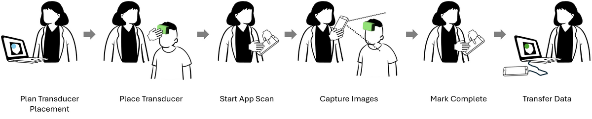

*Figure 2 — Overview of the photogrammetry workflow: plan the transducer placement, place the transducer on the subject, start the scan in the app, capture images, mark the scan complete, and transfer the data to the PC.*

### Photocollection best practices

When capturing a photocollection, follow these best practices:

1. Seat the subject in a comfortable, slightly reclined position. Neck support
   is recommended, but the neck rest should not block or obscure the back of
   the head.
2. Minimize background noise: capture in a well-lit area that is free of
   clutter, with no people moving in the background.
3. The subject should keep their eyes closed while the images are collected.
4. Get as close as possible to the subject. Fill as much of the on-screen oval
   as possible with the subject's head and the transducer.
5. Complete a full 360° circle around the subject, walking
   **counterclockwise** as instructed by the app.
6. Maintain a slow and steady pace and do not stop part way through. Make sure
   each image is captured (the "bucket" turns green) before moving on to the
   next image, to avoid blurring.
7. Capture the full **120 images**.

!!! note
    Photocollections with fewer than 120 images may produce low-quality
    reconstructions.

### Recommended capture method (Online and Offline)

When starting capture, make sure the phone is facing the front of the subject
and the subject is leaning back at a slight angle — for example, in a reclining
chair with a neck rest.

Move the phone in a **"sine wave"** as you walk counterclockwise around the
subject:

1. Start by facing the subject, then begin walking counterclockwise.
2. Slowly lower the phone as you reach the left side of the subject, making
   sure to fully capture the left side of the transducer.
3. Gradually raise the phone as you reach the back of the head to capture the
   top of the transducer. Having the subject reclined helps with this part of
   the capture.
4. Continue around to the subject's right side, and slowly lower the phone to
   get a complete view of the right side of the transducer.
5. As you complete the full circle, slowly raise the phone so it is level with
   the subject's head once again.

This captures the front, sides, and top of the transducer and ensures complete
coverage of the head and transducer from various angles. The method is
illustrated in the [Appendix](#appendix-sine-wave-capture-method).

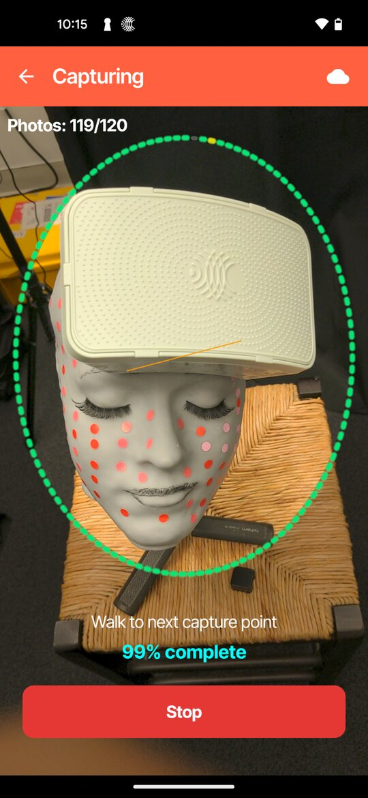{ width="280" }

*Figure 3 — Front view, captured straight on with the subject's face and the front of the transducer filling the on-screen oval (steps 1 and 5).*

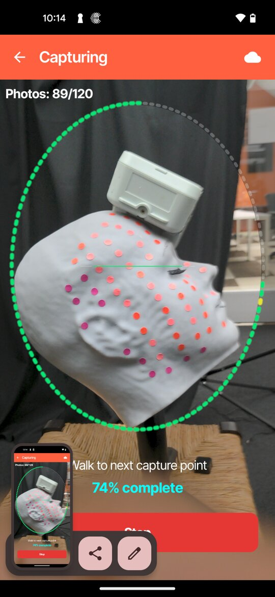{ width="280" }

*Figure 4 — Side view, captured with the phone lowered to show the full side of the transducer (steps 2 and 4).*

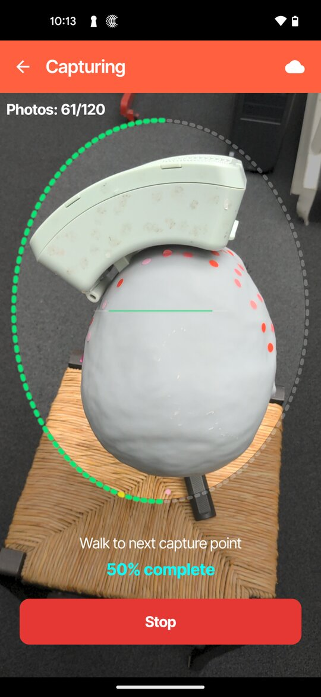{ width="280" }

*Figure 5 — Top view, captured from behind the subject with the phone raised to show the top of the transducer (step 3).*

## Running the app

The app can be used in **Online Mode**, which reconstructs the photoscan in the
cloud, or **Offline Mode**, which reconstructs it locally on the PC. Use the
table below to choose the workflow that matches your setup, then follow the
steps for that workflow.

!!! note "Cloud data retention"
    All images synced with Openwater's Cloud Services are automatically and
    permanently deleted within 24 hours of being uploaded.

| Workflow | When to use | How the photoscan reaches the PC |
| --- | --- | --- |
| [**Option 1 — Online Mode: Full Internet Access**](#option-1-online-mode-full-internet-access) | You have a Cloud Services account and the PC has internet access. | Reconstructed in the cloud and synced automatically to the Open-LIFU Desktop Application or Slicer Open-LIFU. |
| [**Option 2 — Online Mode: Limited Internet Access**](#option-2-online-mode-limited-internet-access) | You have a Cloud Services account, but the PC does not have internet access. | Reconstructed in the cloud and transferred to the PC by USB cable. |
| [**Offline Mode**](#offline-mode-local-reconstruction) | You do not have a Cloud Services account. | The photocollection is transferred to the PC by USB cable and reconstructed locally (requires a GPU). |

*Table 1 — Choosing a photogrammetry workflow.*

### Online Mode: cloud reconstruction

1. Open the application on the phone. Read the Research Device Notice and tap
   **OK** to accept the terms and conditions. The notice appears each time the
   app opens unless **Don't show again** is selected.
2. When opening the application for the first time, enable the permissions
   displayed on screen (photo/video access and location).

    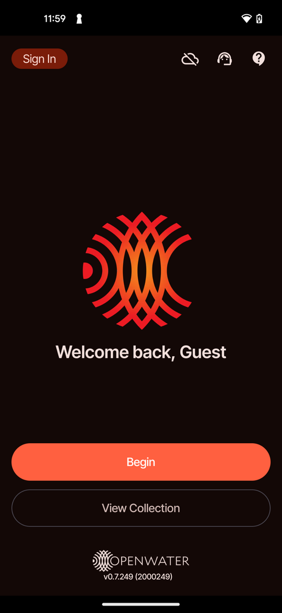{ width="260" }

    *Figure 6 — Home screen before signing in. Tap **Sign In** in the top left corner to log into your Cloud Services account (step 3).*

3. Tap **Sign In** and log into your Cloud Services account. Accounts are
   managed by Openwater or a local admin
   ([console.openwater.health](https://console.openwater.health/)). For help
   logging in, contact your local admin or Openwater representative.

    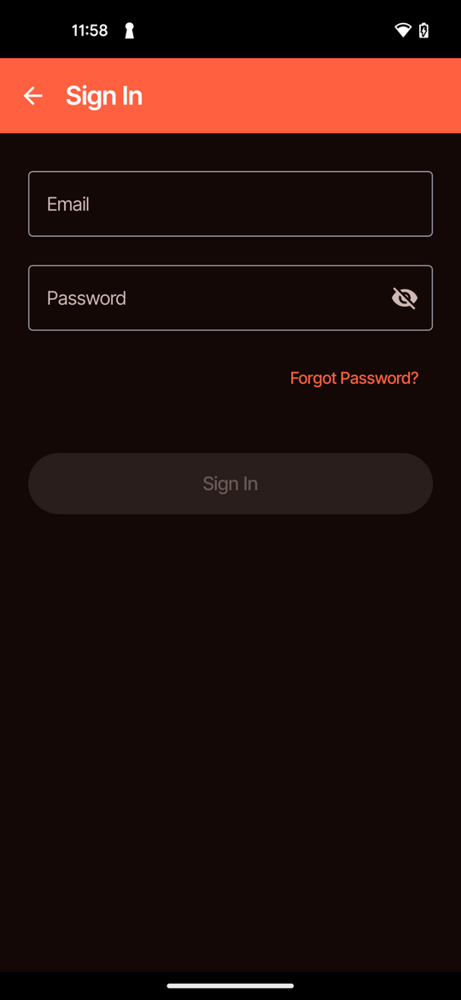{ width="260" }

    *Figure 7 — Sign In screen. Enter the email and password for your Cloud Services account (step 3).*

4. Once logged in, the app shows how many credits are available for scanning
   (1 credit per scan). Tap **Begin**.

    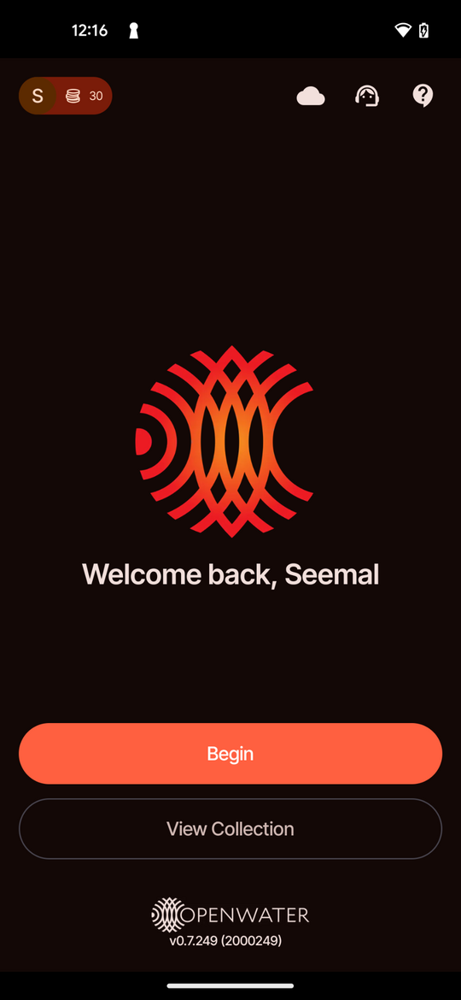{ width="260" }

    *Figure 8 — Home screen after signing in. Your name and the number of available credits appear in the top left corner. Tap **Begin** to start a new photocollection (step 4).*

5. When you tap **Begin**, you have two options: **Existing Subject**
   (Option 1) or **Manually Input** (Option 2).

#### Option 1 — Online Mode: Full Internet Access

1. Make sure you are signed in, following the
   [Online Mode sign-in steps](#online-mode-cloud-reconstruction). Tap
   **Begin**.
2. Tap **Existing Subject**.
3. Choose the subject and session that were selected in the Open-LIFU Desktop
   Application. These sync automatically to the app for the user to select
   from.

    !!! note
        If the Subject or Session ID is not displayed, drag your finger down
        from the top of the phone screen to refresh the list.

    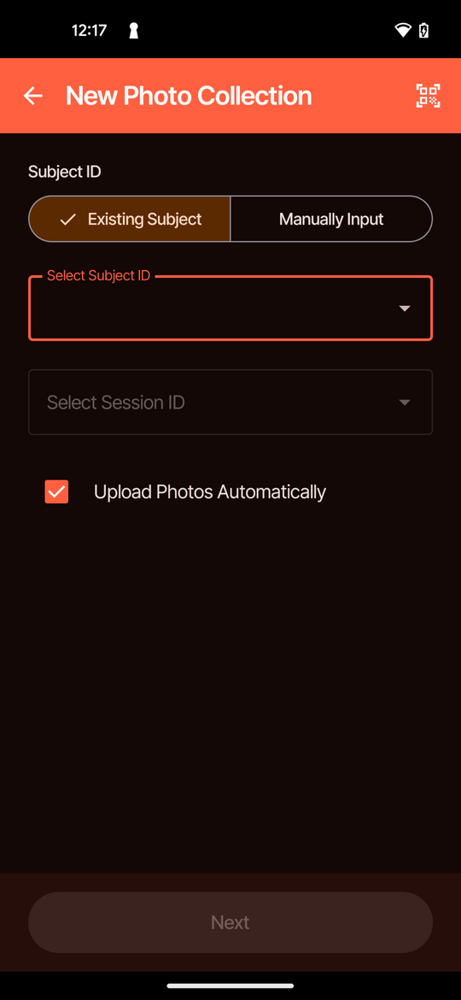{ width="260" }

    *Figure 9 — New photocollection screen with **Existing Subject** selected. Select the Subject ID and Session ID that match the session in the Open-LIFU Desktop Application (step 3).*

4. Tap **Next** to open the capture screen.

    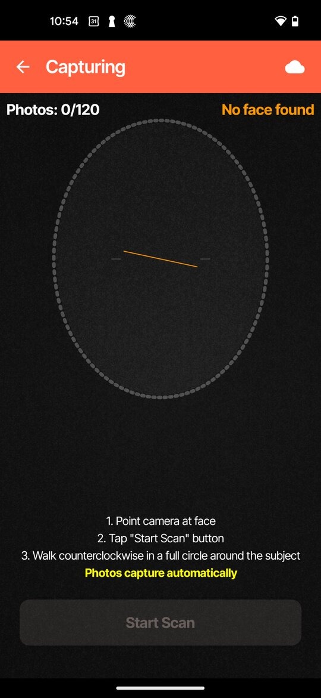{ width="260" }

    *Figure 10 — Capture screen before scanning. Point the camera at the subject's face. **Start Scan** becomes available when "Face ready" appears (step 5).*

5. Point the camera at the subject's face. When a face is detected ("Face
   ready" appears at the top of the screen), tap **Start Scan** and walk
   counterclockwise in a full circle around the subject. Photos are captured
   automatically.

    !!! note
        Follow the [photocollection best practices](#photocollection-best-practices).
        The app captures photos automatically and moves to the next screen when
        all 120 images are captured. **Stop** becomes available after 20 images;
        stopping early produces a less detailed photoscan, resulting in
        poor-quality reconstructions. After stopping, tap **Proceed** to keep the
        images or **Re-capture** to start again.

6. Once scanning is complete, the photoscan is automatically transferred to the
   photogrammetry section of the Open-LIFU Desktop Application or Slicer
   Open-LIFU. Click **Refresh** in the application if it does not show up
   immediately.

    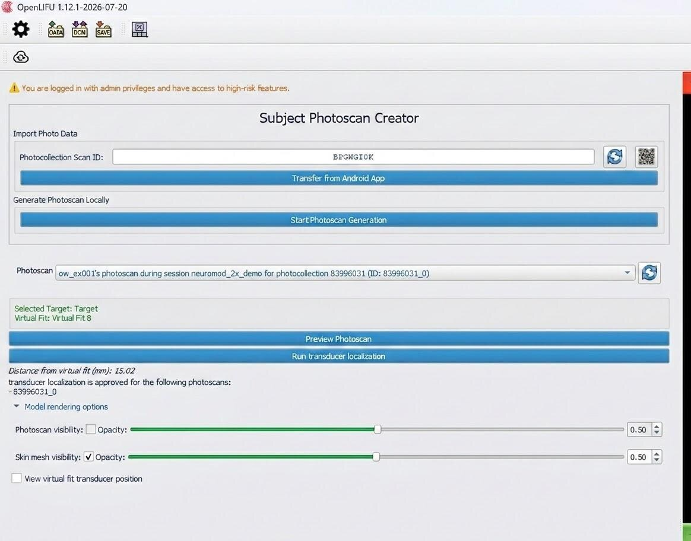

    *Figure 11 — Subject Photoscan Creator in the Open-LIFU Desktop Application. The cloud-reconstructed photoscan appears in the Photoscan list. If it does not appear, click the refresh button (blue double-arrows) beside the list (step 6).*

#### Option 2 — Online Mode: Limited Internet Access

!!! note
    Manual Input may be used when the PC has no internet access but the user
    still wants cloud reconstruction. It lets the user transfer the
    cloud-reconstructed images directly onto the PC via USB.

1. Make sure you are signed in, following the
   [Online Mode sign-in steps](#online-mode-cloud-reconstruction). Tap
   **Begin**.
2. Tap **Manually Input**. In the Open-LIFU Desktop Application, go to the
   **Subject Photoscan Creator** and generate a Subject Scan ID using the blue
   double-arrows. On the phone, type the ID into the **Input Subject Scan ID**
   field, or click the QR code icon on the PC and use the app to scan the QR
   code displayed in the desktop application.

    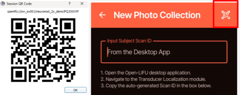

    *Figure 12 — Generating the Subject Scan ID in the Open-LIFU Desktop Application also generates the QR code. Use the blue double-arrows to generate the Photocollection Scan ID, then type in the ID or use the QR code icon to display a QR code for the app to scan (step 2).*

3. Tap **Next** to begin capturing.

    { width="260" }

    *Figure 13 — Capture screen before scanning. Point the camera at the subject's face and tap **Start Scan** when "Face ready" appears (step 4).*

4. Point the camera at the subject's face. When a face is detected ("Face
   ready" appears at the top of the screen), tap **Start Scan** and walk
   counterclockwise in a full circle around the subject. Photos are captured
   automatically.

    !!! note
        Follow the [photocollection best practices](#photocollection-best-practices).
        The app captures photos automatically and moves to the next screen when
        all 120 images are captured. **Stop** becomes available after 20 images;
        stopping early produces a less detailed photoscan, resulting in
        poor-quality reconstructions. After stopping, tap **Proceed** to keep the
        images or **Re-capture** to start again.

5. Once the scan is complete, connect the phone to the PC running the Open-LIFU
   Desktop Application or Slicer Open-LIFU using a USB-C cable.
6. Tap **Transfer to PC** on the phone, then click **Transfer from Android App**
   in the Open-LIFU Desktop Application. Wait until the phone displays
   "Status: Completed" and the photocollection appears in the desktop
   application.

### Offline Mode: local reconstruction

1. Open the application on the phone. Read the Research Device Notice and tap
   **OK**. The notice appears each time the app opens unless
   **Don't show again** is selected.

    { width="260" }

    *Figure 14 — Home screen in Offline Mode. Do not sign in. Tap **Begin** to start a new photocollection (step 3).*

2. When opening the application for the first time, enable the following
   permissions while using the application:
    - Photo/video access
    - Location sharing
3. Tap **Begin**. **Do not sign in.**
4. In the Open-LIFU Desktop Application, open the **Transducer Localization**
   module and click the blue double-arrows to generate a new Subject Scan ID. On
   the phone, type the ID into the **Input Subject Scan ID** field, or tap the QR
   code icon and scan the QR code displayed in the desktop application.

    

    *Figure 15 — Generating the Subject Scan ID in the Open-LIFU Desktop Application. Use the blue double-arrows to generate the Photocollection Scan ID, then type in the ID or use the QR code icon to display a QR code for the app to scan (step 4).*

5. Tap **Next** to begin capturing.
6. Point the camera at the subject's face. When a face is detected ("Face
   ready" appears at the top of the screen), tap **Start Scan** and walk
   counterclockwise in a full circle around the subject. Photos are captured
   automatically.

    !!! note
        Follow the [photocollection best practices](#photocollection-best-practices).
        The app captures photos automatically and moves to the next screen when
        all 120 images are captured. **Stop** becomes available after 20 images;
        stopping early produces a less detailed photoscan, resulting in
        poor-quality reconstructions. After stopping, tap **Proceed** to keep the
        images or **Re-capture** to start again.

    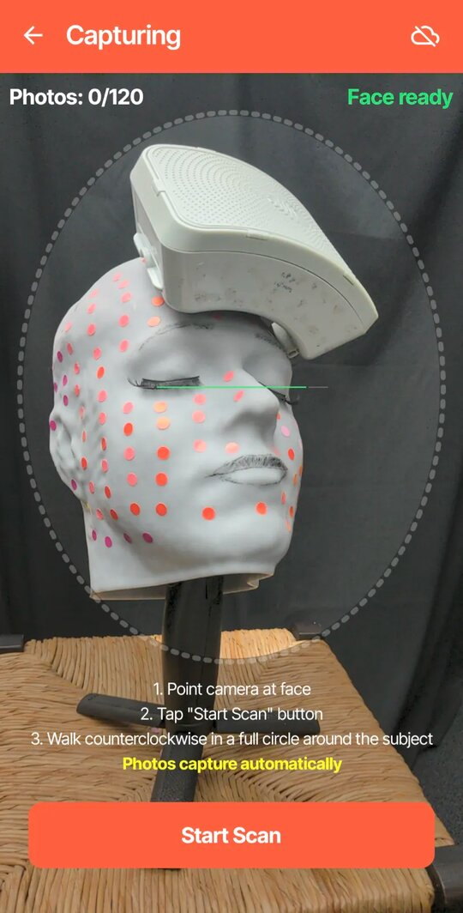{ width="260" }

    *Figure 16 — Capture screen before scanning. Point the camera at the subject's face and tap **Start Scan** when "Face ready" appears (step 6).*

7. Once the scan is complete, connect the phone to the PC running the Open-LIFU
   Desktop Application or Slicer Open-LIFU using a USB-C cable.
8. Tap **Transfer to PC** on the phone, then click **Transfer from Android App**
   in the Open-LIFU Desktop Application. Wait until the phone displays
   "Status: Completed" and the photocollection appears in the desktop
   application.
9. Use the desktop application to reconstruct the 3D mesh.

For Offline Mode, the following settings are recommended before starting
reconstruction:

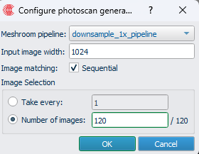

*Figure 17 — Recommended Offline Mode settings in the "Configure photoscan generation" window: Meshroom pipeline `downsample_1x_pipeline`, input image width 1024, Sequential image matching, and 120 images.*

### Viewing and managing photocollections

Photocollections remain on the phone after capture. Use **View Collection** to
review, transfer, or delete them.

1. On the home screen, tap **View Collection**. Each photocollection is listed by
   its Subject Scan ID, with the capture date and the number of photos.
2. Tap a photocollection to open it. If the photoscan has not been processed
   ("Scan Not Processed"), tap **Transfer to PC** to transfer the
   photocollection to the PC by USB cable.
3. Tap **Photos** to scroll through the captured images. To delete individual
   images, select them and tap **Delete**.
4. To delete the entire photocollection, tap the three-dot menu in the top
   right corner and select **Delete Scan**.

## Customer support

For help with the Open-LIFU Photogrammetry App, contact Openwater Support using
the information below or the details provided in your Service Agreement.

- **Email** — [support@openwater.cc](mailto:support@openwater.cc)
- **Phone** — (415) 484-3776
- **Web** — [www.openwater.health](https://www.openwater.health)
- **Community** — [Discord](https://discord.gg/fS7vfAX4fA)

From the app, tap the **Customer Support** icon (headset) on the home screen to
email, call, or visit the Openwater website. Tap the **Support & Legal** icon
(question mark) to watch the video tutorial, submit feedback, or view the
Research Device Notice.

## Troubleshooting

| Issue | Potential cause | Recommended steps |
| --- | --- | --- |
| **Slow photogrammetric reconstruction** | PC is underpowered | Use Online Mode to generate the photoscan. |
| | The app is outdated | Update to the latest version of the app from the Google Play Store. |
| **Cannot connect to the app (Offline)** | Cable not properly connected; faulty cable; incompatible drivers; computer antivirus blocks access | Inspect connection cables, verify drivers, and allow application access through network and security settings. |
| | ADB not installed; environment variables not set properly | Go to the Login page and confirm ADB has a green checkmark next to it. If not, click the button to install it. |
| **Cannot connect to the app (Online)** | Not signed into Openwater's Cloud Services on both devices, or not signed in with the same account | Make sure you are signed into both devices with the same Cloud Services account. |
| | Cloud account does not exist | Make sure you have an active Cloud Services account. |
| | The app is outdated | Update to the latest version of the app from the Google Play Store. |
| | Unstable or no network connection | Check the network connection; connect to a different network; contact your IT department or network provider if the problem persists. |
| **Open-LIFU application is not synchronizing with the app (Online)** | Not signed into Cloud Services on both devices with the same account | Make sure you are signed into both devices with the same Cloud Services account. |
| | Cloud account does not exist | Make sure you have an active Cloud Services account. |
| | Unstable or no network connection | Check the network connection; connect to a different network; contact your IT department or network provider if the problem persists. |
| **Photocollections are not synchronizing from the app to the cloud** | Not signed into Cloud Services on the app | Make sure you are signed into the app with the same Cloud Services account. |
| | Cloud account does not exist | Make sure you have an active Cloud Services account. |
| | Cloud reconstruction credits have been exhausted | Contact Openwater Support. |
| | The app is outdated | Update to the latest version of the app from the Google Play Store. |
| | Unstable or no network connection | Check the network connection; connect to a different network; contact your IT department or network provider if the problem persists. |
| **Slow system performance** | No or incompatible graphics card; graphics card not functioning; too many programs, apps, or background processes running | Use the recommended GPU and make sure drivers are up to date. Close all other programs and apps before running Open-LIFU. |
| **Poor image reconstruction** | Low-quality photocollection; background in the photos may be too "busy" | Make sure the app is up to date. Follow the [best practices](#photocollection-best-practices) for capturing images. |
| | Phone held too far from the subject's head/face | Adjust closeness and camera position relative to the subject. |
| **Poor photogrammetry registration with the MRI** | Low-quality image reconstruction (photoscan) | Make sure the app is up to date. |
| | Selected anatomical landmarks or features between the 3D mesh and MRI do not match | Accurately select corresponding anatomical landmarks or features on both the 3D mesh and MRI. |
| **Transducer shifts on the subject after the photogrammetry mesh has been acquired** | The transducer was not properly secured to the subject, or was accidentally bumped | Adjust the transducer straps to hold it firmly in place and recapture the photogrammetry mesh. If necessary, adjust the transducer, recapture the mesh, and repeat session planning. Make sure the subject is seated comfortably so movement is minimal. |
| **"No face found" or "Move closer" appears during capture** | The subject's face is not inside the on-screen oval, or the phone is too far from the subject | Point the camera at the subject's face and move closer until "Face ready" appears. Fill as much of the oval as possible with the subject's head and the transducer. |

*Table 2 — Common troubleshooting issues, potential causes, and recommended steps.*

## Appendix: sine wave capture method

This appendix illustrates the [recommended capture method](#recommended-capture-method-online-and-offline).
Walk counterclockwise around the subject while moving the phone up and down in a
"sine wave."

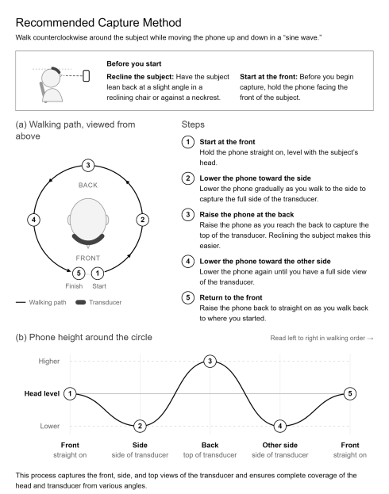

*Figure 18 — Sine wave capture method, showing the counterclockwise walking path around the subject and the phone height at each position.*

## Related documentation

| For | See |
|---|---|
| The PC-side Transducer Localization workflow | [Open-LIFU User Manual (LBL-00009)](user-manual.md) |
| Transducer Localization in 3D Slicer | [Slicer Open-LIFU](slicer.md#transducer-localization) |
| App source code | [`OpenLIFU-3DScanner`](https://github.com/OpenwaterHealth/OpenLIFU-3DScanner) on GitHub |
| Evidence on localization accuracy | [Open-LIFU Transducer Localization Accuracy Study](../research/openlifu/transducer-localization-accuracy/index.md) |

---

*This page reflects LBL-00017 Revision A, app software v0.7.257, released
2026-10-21. All information — including product features, specifications, and
descriptions — is subject to change without notice. For the controlled
revision, use the
[PDF](LBL-00017-RevA-Open-LIFU-Photogrammetry-App-User-Manual.pdf).*

*CAUTION — The system described here has not been evaluated by the FDA and is
not designed for the treatment or diagnosis of any disease. It is provided
AS-IS, with no warranties. User assumes all liability and responsibility for
identifying and mitigating risks associated with using this software.*
